# Mint-OS : Linux Mint sur NumWorks

**Mint-OS remplace l'écran d'accueil de la calculatrice NumWorks (n0110, n0115 ou n0120) par
un bureau inspiré de Linux Mint (Cinnamon).** Au démarrage : le menu GRUB,
le logo qui charge, l'écran de connexion. Puis le panneau Cinnamon, le menu
avec ses catégories, de vraies fenêtres, deux espaces de travail, et un
**terminal avec de vraies commandes Linux** : `ls`, `cd`, `cat`, `sudo`,
`apt install`, `neofetch`, `vim` (bonne chance pour en sortir)… et
`sudo rm -rf / --no-preserve-root`, pour les courageux.

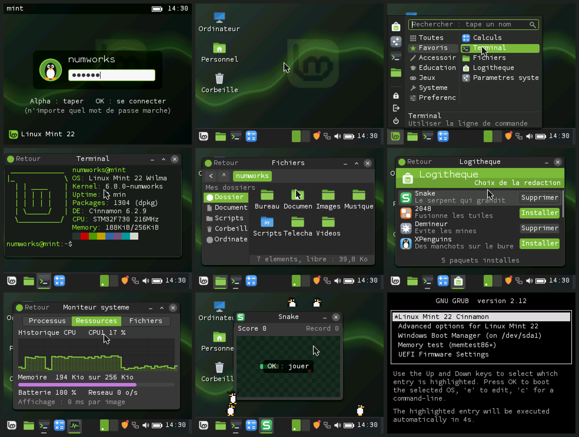

<p align="center">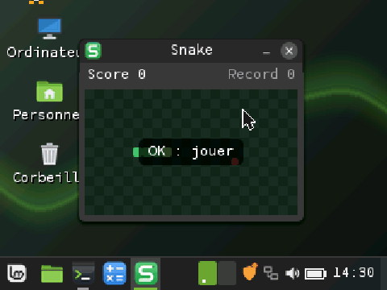</p>

> Captures prises dans le simulateur (horloge réglée sur 14:30, batterie à
> 100 %).

## Ce que fait Mint-OS

### Le démarrage, comme un vrai PC sous Linux

- **GRUB** : « Linux Mint 22 Cinnamon », les options avancées (démarrage
  avec les messages de systemd en vert), **Windows Boot Manager** (« error:
  no such device: Windows »), **Memtest86+** qui teste les 256 Ko de RAM, et
  les réglages UEFI (« il n'y a pas de BIOS, c'est une calculatrice »).
  Compte à rebours de 5 s, arrêté dès qu'on touche une flèche.
- **Plymouth** : le logo Mint et ses points. Retour ou Boîte à outils
  affiche les messages de démarrage `[  OK  ] Started …`.
- **Écran de connexion** (LightDM) : avatar pingouin, utilisateur
  `numworks`, mot de passe en points. N'importe quel mot de passe marche.

### Le bureau Cinnamon

- **Panneau du bas** : bouton Menu (le logo Mint), applis épinglées et
  fenêtres ouvertes (trait vert sous l'appli active), **sélecteur d'espaces
  de travail**, bouclier du **gestionnaire de mises à jour** (orange tant
  qu'il y a des mises à jour), réseau (câble USB), son, batterie, horloge
  et le coin « afficher le bureau ».
- **Menu** : recherche en tapant directement, favoris à gauche (Logithèque,
  Paramètres, Terminal, Fichiers), boutons Verrouiller / Fermer la session /
  Quitter, **catégories qui changent au survol** comme dans Cinnamon
  (Toutes, Favoris, Accessoires, Éducation, Jeux, Système, Préférences),
  description de l'appli en bas.
- **Applets** : calendrier du mois, son (« aucun haut-parleur trouvé »),
  batterie + luminosité, réseau.
- **Icônes du bureau** : Ordinateur, Personnel, Corbeille (un clic
  sélectionne, un deuxième ouvre, comme un double-clic).
- **Clic droit sur le bureau** : nouveau script Python (vraiment créé dans
  la calculatrice), ouvrir un terminal, moniteur système, arrière-plan.
- **Fenêtres Mint-Y** : titre centré, réduire / maximiser / fermer, menu de
  la barre de titre (dont « Vers l'autre espace de travail »), déplacement
  à la souris.
- **Alt+Tab** (touche `x,n,t`), **notifications** en haut à droite,
  **écran de verrouillage** (et après la mise en veille), boîte de dialogue
  « Quitter » (Veille, Redémarrer, Éteindre).
- **Tes calculs en notification** : tape `6×7` dans Calculs, reviens sur le
  bureau : « 42 : la réponse. Fermez internet. » (`666`, `1337`, `1+1`, `π`
  et les erreurs ont aussi leur message).

### Les applis

| Appli | Ce qu'elle fait |
| --- | --- |
| **Terminal** | un vrai petit bash, voir plus bas |
| **Fichiers** (Nemo) | dossier personnel, Documents (fichiers de la calculatrice), Scripts (Python), Corbeille, Ordinateur avec l'espace utilisé ; ouvrir, supprimer (avec confirmation) |
| **Moniteur système** | processus (tue `cinnamon` pour le faire planter, `Xorg` pour fermer la session, `systemd` pour… essaie), graphique CPU, mémoire, systèmes de fichiers |
| **Mises à jour** | installe les mises à jour (barre de progression), le bouclier du panneau passe au vert |
| **Logithèque** | installe ou supprime Snake, 2048, Démineur, XPenguins, cowsay, sl, cmatrix, fortune, neofetch |
| **Paramètres système** | thème sombre / clair, **8 couleurs d'accentuation** (Menthe, Aqua, Bleu, Violet, Rose, Rouge, Orange, Sable), 4 arrière-plans, luminosité, **éclairage nocturne**, vitesse du pointeur, infos système |
| **Écran d'accueil** | la fenêtre de bienvenue de Mint au premier démarrage |
| **Snake, 2048, Démineur** | à installer depuis la Logithèque ou `sudo apt install` |
| **XPenguins** | des manchots qui marchent sur le panneau **et sur tes fenêtres**, et tombent quand il n'y a plus rien sous leurs pattes |

### Le terminal

```
numworks@mint:~$ neofetch
numworks@mint:~$ sudo apt install sl
[sudo] Mot de passe de numworks :
numworks@mint:~$ sl
```

- **Fichiers** : `ls` (`-l`, `-a`), `cd`, `pwd`, `cat`, `rm`, `touch x.py`,
  `mv`, `cp`, `echo "print(42)" > test.py` (écrit vraiment un script
  Python), `cat /etc/os-release`, `cat /proc/cpuinfo`…
- **Système** : `uname -a`, `whoami`, `id`, `ps`, `top` / `htop`, `kill`,
  `free`, `df`, `uptime`, `date` (et `sudo date -s 14:30` pour régler
  l'horloge), `cal`, `history` (avec **tes calculs de l'appli Calculs**),
  `lscpu`, `lsusb`, `dmesg`, `ip a`, `ping`, `reboot`, `shutdown`.
- **sudo** comme le vrai : la leçon au premier usage, le mot de passe
  caché, retenu 5 minutes. `cat /etc/shadow` refusé sans lui.
- **apt** : `apt update`, `apt upgrade`, `apt install`, `apt remove`,
  `apt search`, `apt list`… qui installent vraiment les jeux et les
  commandes. Sans sudo : « E: Êtes-vous root ? ». Une commande pas installée
  te dit comment l'installer.
- **Pour rire** : `neofetch`, `cowsay` (et `cowsay -f tux`), `fortune`, `sl`
  (impossible à arrêter, comme le vrai), `cmatrix`, `yes`, `vim` (pour
  sortir : `:q` puis EXE), `apt moo`, `make me a sandwich` puis
  `sudo make me a sandwich`, `apt install windows`, `apt install cerveau`…
- **`sudo rm -rf / --no-preserve-root`** : le terminal efface tout, le
  bureau disparaît, **kernel panic**, la LED passe au rouge, et la
  calculatrice redémarre sur GRUB. **Rien n'est vraiment effacé.**
- `bc` (calculatrice dans la calculatrice), `python3` ouvre l'appli Python,
  **Boîte à outils = Tab** (complétion), flèches haut/bas = historique.

<p align="center">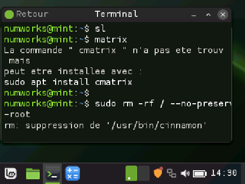</p>

| GRUB | Connexion | Menu |
| --- | --- | --- |
| 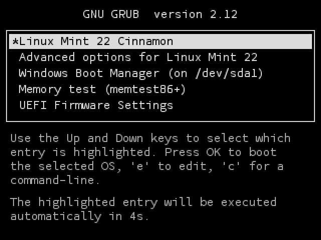 | 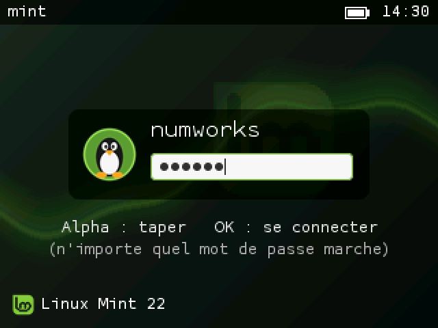 | 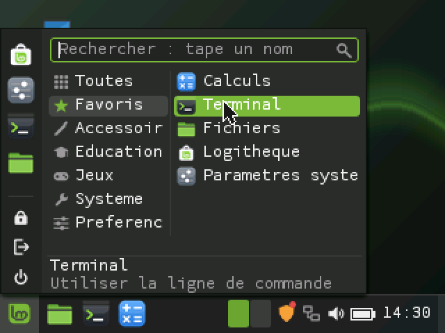 |

| Terminal : neofetch | apt install | cowsay |
| --- | --- | --- |
| 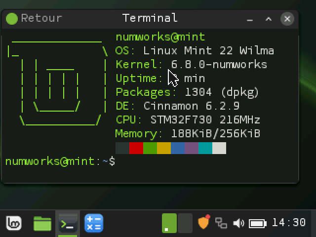 | 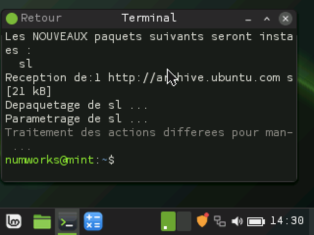 | 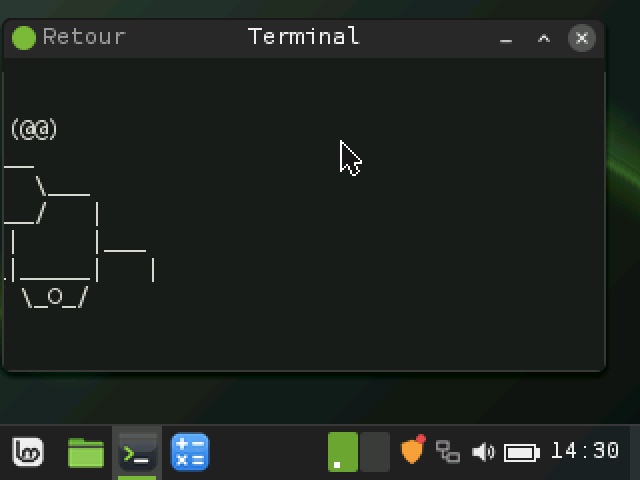 |

| Fichiers | Logithèque | Moniteur système |
| --- | --- | --- |
| 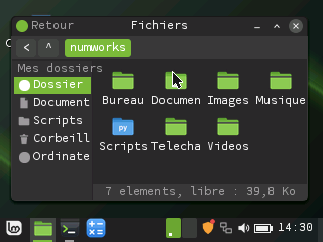 | 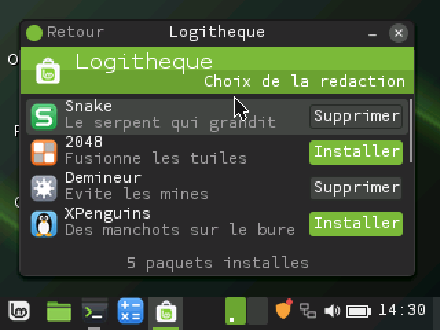 | 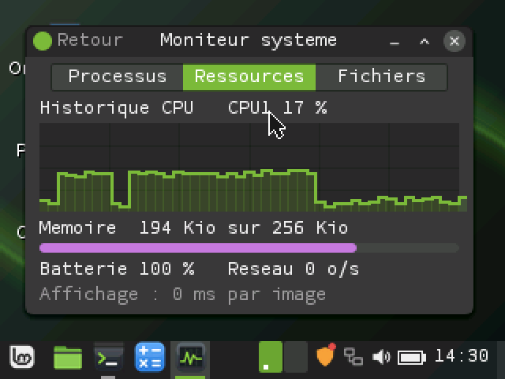 |

| Paramètres | Mises à jour | Calendrier |
| --- | --- | --- |
| 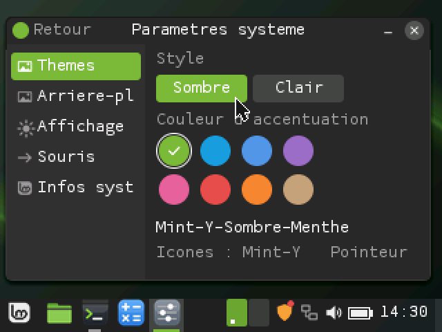 | 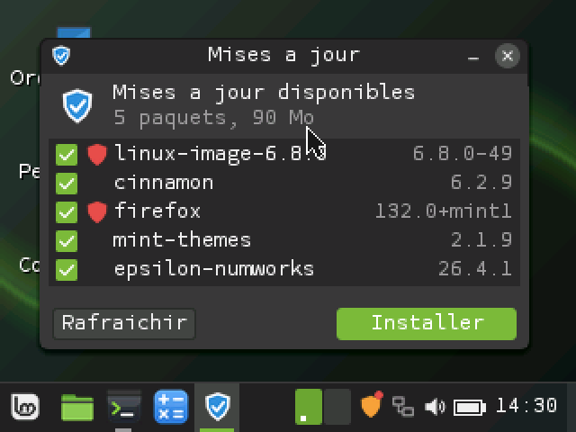 | 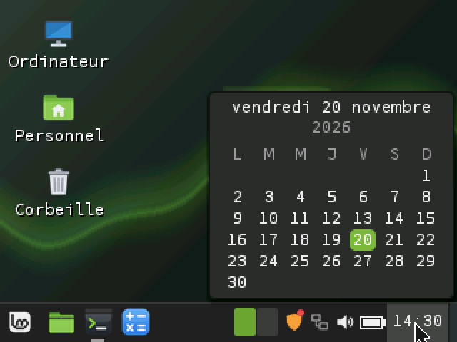 |

| Cinnamon a planté | Kernel panic | Verrouillage |
| --- | --- | --- |
| 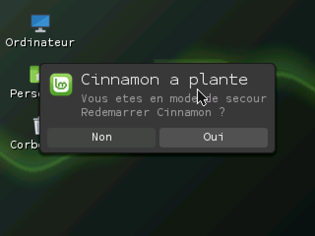 | 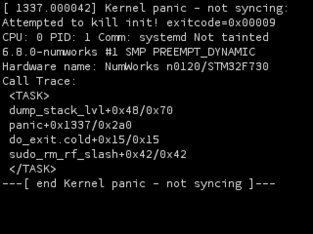 | 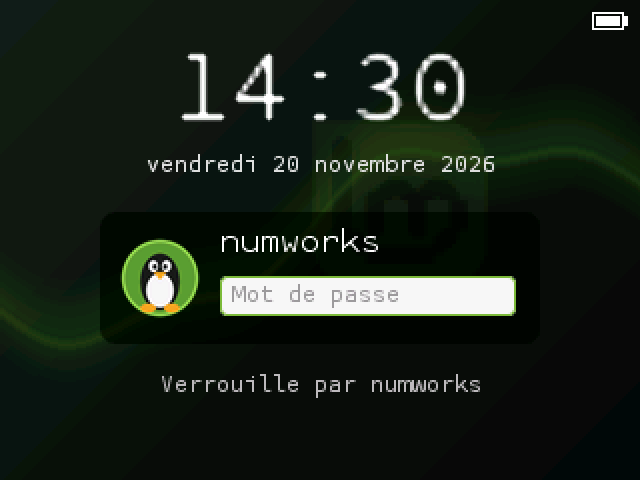 |

## Commandes

| Touche | Sur le bureau | Dans une fenêtre qui a le clavier |
| --- | --- | --- |
| Flèches | déplacer le pointeur | naviguer / jouer |
| OK ou EXE | clic | valider |
| Boîte à outils | clic droit | Tab (complétion) dans le terminal |
| Var | touche Super : ouvrir / fermer le menu | — |
| x,n,t | Alt+Tab | — |
| Home ou Retour | ouvrir le menu, fermer un menu | rendre la main au pointeur |
| Alpha | lettres (recherche, mot de passe) | lettres |
| On/Off | veille | veille |

## Installation

### 1. Obtenir Mint-OS

Depuis juillet 2021, le code d'Epsilon (le logiciel de la NumWorks) n'est plus
sous licence libre. Mint-OS ne publie donc **aucun code ni aucun firmware de
NumWorks** : seulement un **patch** (`patches/mint-os-epsilon.patch`) et son
propre code. Le firmware se compile à partir des sources officielles de
NumWorks, dans ton compte GitHub ou sur ton Mac.

**Sans rien compiler (Mac ou Windows)**

1. En haut de cette page : **Use this template** > **Create a new repository**,
   coche **Private** (obligatoire : la compilation refuse de tourner dans un
   dépôt public).
2. Facultatif : ajoute tes jeux `.nwa` dans le dossier `games/` de ta copie
   privée.
3. Dans ta copie : onglet **Actions** > **Build Mint-OS** > **Run workflow**.
4. Environ 30 minutes plus tard (un firmware par modèle), télécharge **Mint-OS-Mac** ou
   **Mint-OS-Windows** en bas de la page de la compilation.

**En compilant sur ton Mac**

```bash
brew install make dfu-util libusb
brew install --cask gcc-arm-embedded
git clone https://github.com/derim00/linux-os.git && cd linux-os
./scripts/build-firmware.sh
```

### 2. Installer sur la calculatrice

- **Mac** : double-clique sur **`Installer Mint-OS.command`** (la première
  fois : clic droit > Ouvrir). La page s'ouvre sur http://127.0.0.1:8773.
- **Windows** : décompresse **Mint-OS-Windows**, double-clique sur
  **`Installer Mint-OS.exe`** (rien à installer : ni Python, ni pilote).

Branche la calculatrice, appuie sur **Reset** au dos, attends le voyant vert
dans la page, puis **Installer Mint-OS**. Seul le **slot B** est écrit : le
système officiel (slot A) n'est jamais modifié.

## À savoir

- **Calculatrice** : NumWorks **n0110**, **n0115** ou **n0120**, logiciel officiel **26.4.0** dans
  le slot A.
- **Trois modèles** : la compilation produit un firmware par modèle
  (n0110, n0115, n0120) et l'installateur choisit tout seul celui de la
  calculatrice branchée. Mets d'abord ta calculatrice à jour sur
  numworks.com : le système doit avoir la même version que le logiciel
  officiel du slot A.
- **Jeux trop gros** : un jeu qui ne tient pas dans le slot B (NumPlay,
  par exemple) est ignoré avec un message, au lieu de faire échouer la
  compilation. Retire-le du dossier `games/`.
- **Un seul système dans le slot B** : Mint-OS remplace Windows-OS,
  Switch-OS, PSP-OS… (et inversement).
- **Horloge** : la calculatrice n'a pas d'horloge temps réel ; l'heure part
  de 00:00 et la date est celle de la compilation. Règle-la avec
  `sudo date -s 14:30`.
- **Accents** : la police de la NumWorks n'a pas de lettres accentuées ; les
  textes s'affichent sans accents, comme quand on tape sur la calculatrice.
- Le correctif du plantage Home / On-Off de Windows-OS est repris tel quel.

## Comment c'est fait

| Fichier (dans le patch) | Rôle |
| --- | --- |
| `apps/home/mint/shell.cpp` | GRUB, Plymouth, connexion, panneau, menu, fenêtres, espaces de travail, applets, notifications, XPenguins |
| `apps/home/mint/apps.cpp` | Fichiers, Moniteur système, Mises à jour, Logithèque, Paramètres, Écran d'accueil, jeux |
| `apps/home/mint/terminal.cpp` | le terminal : commandes, sudo, apt, vim, bc, sl, cmatrix |
| `apps/home/mint/gfx.cpp` | rendu par bandes en RAM, texte, fonds d'écran calculés, pointeur Bibata |
| `apps/home/mint/gen_icons.py` | dessine toutes les icônes (style Mint-Y) dans `mint_icons.h` |
| `apps/home/mint/calc.cpp` | garde les derniers résultats de Calculs (notifications, `history`) |
| `scripts/photos.py` | transforme la séance photo du simulateur (`MINT_SHOTS=dossier`) en PNG et GIF |

## Licence

Le code de Mint-OS est sous licence **CC BY-NC-SA 4.0** (voir `LICENSE`).
Epsilon reste la propriété de NumWorks et n'est pas inclus dans ce dépôt.
Mint-OS est un projet de fan, sans lien avec Linux Mint ni avec NumWorks ;
Linux Mint est une marque de Clément Lefebvre. Les icônes, le logo
simplifié, les fonds d'écran et le pingouin sont des dessins originaux
faits pour ce projet.
